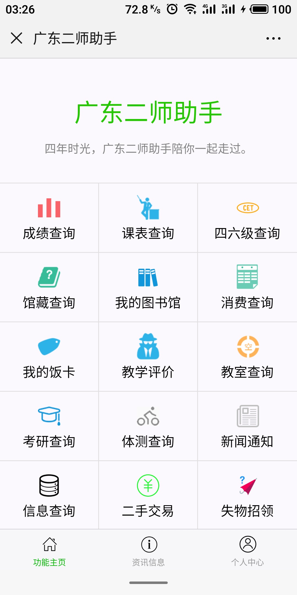
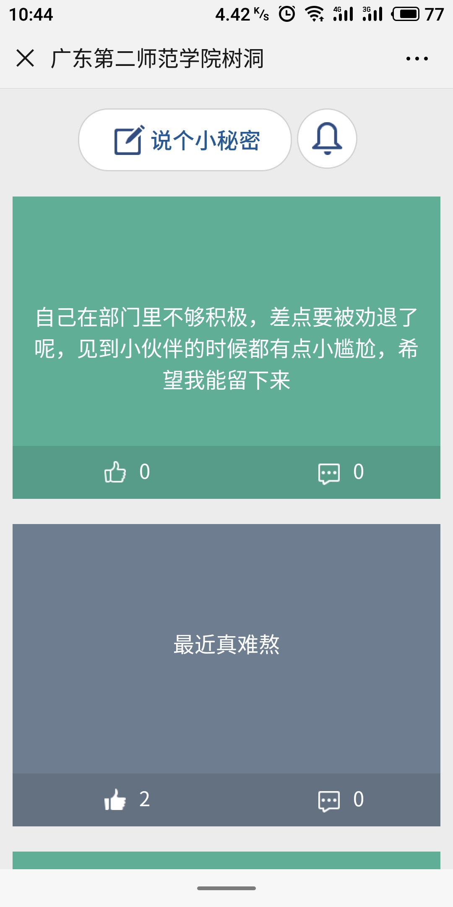

# GdeiAssistant | 广东第二师范学院校园助手系统


广东第二师范学院校园助手系统的服务端与网页端，配套 Android、iOS 和微信小程序客户端。

学生用它查课表、成绩、借阅、跑腿和二手市场。后端通过模拟登录对接学校教务系统，把分散在多个校内系统里的信息统一成一套 API。

> **本项目是校园助手类项目，不代表学校官方服务。** 使用前请阅读 [法律、隐私与安全提示](#法律隐私与安全提示)。

**目录**

- [功能](#功能)
- [快速开始](#快速开始)
- [配置](#配置)
- [技术栈](#技术栈)
- [AI 服务](#ai-服务)
- [项目结构](#项目结构)
- [测试](#测试)
- [多端契约](#多端契约)
- [预览](#预览)
- [客户端与官网](#客户端与官网)
- [法律、隐私与安全提示](#法律隐私与安全提示)
- [贡献](#贡献)
- [许可证](#许可证)

## 功能

| 模块 | 内容 |
| --- | --- |
| 教务 | 课表、成绩、考试安排、培养方案 |
| 图书 | 借阅查询、续借、馆藏检索 |
| 生活 | 跑腿、二手市场、失物招领 |
| 社交 | 动态、评论、私信 |
| 账号 | 校园账号绑定、JWT 会话、注销与数据清理 |

后端通过爬虫模拟登录获取校内数据，所以它是一套**有状态**的系统：JWT 标识客户端会话，Redis 负责校验会话撤销并保存上游登录状态。

## 快速开始

需要 Docker 与 Docker Compose。前端本地开发另需 Node.js `24.14.1 LTS`（仓库提供 `.nvmrc`）。

```bash
cp .env.template .env
# 编辑 .env，至少填 DB_PASSWORD 和 JWT_SECRET，模板里有注释
docker compose up -d
```

起来之后：

- 后端 API：`http://localhost:8080/api`
- 前端：`http://localhost:5173`

看日志 `docker compose logs -f backend`，停止 `docker compose down`。

Spring Boot 4 内嵌 Web 容器，不需要单独装 Tomcat 或部署 WAR。

### 只跑后端

```bash
./gradlew bootRun
```

会自动加载根目录 `.env`，按 `development` 语义启动。

### 只跑前端

```bash
cd frontend
npm install
npm run dev
```

前端开发服务器默认在 `http://localhost:5173`，需要把接口代理指向本地后端，见 `frontend/vite.config.*` 或 `frontend/.env*`。

## 配置

根目录 `.env` **只服务本地 `development`**，供 `./gradlew bootRun`、`docker compose up -d` 和本地前后端联调用。

三种环境语义：

| 环境 | 用途 | 部署形态 |
| --- | --- | --- |
| `development` | 本地开发 | 仓库内全栈 Docker |
| `staging` | 演示 / 测试 | 前后端与数据库拆开部署 |
| `production` | 正式环境 | 前后端与数据库拆开部署 |

`staging` 和 `production` **不要**复用本地 `.env`，改用各自独立的环境变量配置，例如 Azure App Service App Settings、CI Secret、部署平台 Secret 文件。

### 生产 / 预发必填

缺任何一项都会 fail-fast 拒绝启动：

| 变量 | 说明 |
| --- | --- |
| `DB_PASSWORD` | 数据库密码 |
| `JWT_SECRET` | JWT 签名密钥，至少 32 位随机串 |
| `CRON_SECRET` | 定时任务触发密钥 |
| `ENCRYPT_ENABLE=true` | 必须启用敏感字段加密（校园凭证等） |
| `ENCRYPT_PRIVATE_KEY` | AES 加密密钥 |
| `REDIS_SSL_ENABLED=true` | 连接外部 Redis 时启用 TLS |

外部数据库常用变量：MySQL 的 `DB_USERNAME`、`DB_JDBC_PARAMS`、`DB_JDBC_URL_APP`、`DB_JDBC_URL_LOG`、`DB_JDBC_URL_DATA`；Redis 的 `REDIS_USERNAME`、`REDIS_SSL_ENABLED`；MongoDB 的 `MONGO_URI`。MySQL 目前仍用三套 schema：`DB_NAME`、`DB_NAME_LOG`、`DB_NAME_DATA`。

`JWT_SECRET`、`CRON_SECRET`、`ENCRYPT_PRIVATE_KEY` 需要定期轮换。轮换前先评估已签发 Token 和已加密数据的兼容策略。完整矩阵见 [`docs/environment-matrix.md`](docs/environment-matrix.md)。

## 技术栈

| 端 | 技术 |
| --- | --- |
| 后端 | JDK 17、Spring Boot 4.0、MySQL 8.0、MyBatis-Plus、MongoDB、Redis、Gradle 8.14、GraalVM Native Image（可选） |
| 前端 | Vue 3、Vue Router、Vite、Axios、WeUI、Node.js 24.14.1 LTS |

项目适配了 Docker 容器化和 GraalVM Native Image，可以编译成原生二进制运行。

## AI 服务

成绩、课表这些数据靠模拟登录拿到，但文本处理、图片识别这类任务走独立的 AI 服务层：境内外路由、直连与聚合平台、官方 `latest` 别名与定时模型更新都在那一层。

接入方式和配置见 [AI 服务说明](docs/AI_SERVICES.zh-CN.md)。

## 项目结构

```text
GdeiAssistant/
├── src/main/java/             # 后端 Java 源码
├── frontend/                  # 前端 Vue 3 源码
├── db-init/                   # 数据库初始化
│   ├── mysql/                 # 结构与 Mock 数据
│   └── mongodb/
├── docs/                      # 设计/实现说明（.gitignore 有例外放行）
├── docker-compose.yml         # 本地全栈编排
└── .env.template              # 环境变量模板
```

另有 `docker-compose-staging.yml` 和 `docker-compose-prod.yml` 分别对应测试和生产全栈编排。

## 测试

```bash
./gradlew test

cd frontend
npm ci
npm run build
npm run test:unit
npm run test:e2e
```

后端 CI 跑 `./gradlew test`，覆盖单元、契约和集成边界。前端 CI 跑依赖安装、生产构建、Vitest 单元测试和 Playwright smoke E2E。本地 Playwright 想复用系统 Chrome 时，把 `PLAYWRIGHT_CHROME_EXECUTABLE_PATH` 指向 Chrome 可执行文件。

## 多端契约

[`docs/openapi.yaml`](docs/openapi.yaml) 是从 Controller 请求/响应类型生成的 OpenAPI，作为 Android、iOS、小程序与后端之间的统一参考。

更新方式：

```bash
./gradlew generateOpenApi
./gradlew test checkOpenApi architectureCoverage jacocoTestReport
```

## 预览

<p>
  
  
  
</p>

## 客户端与官网

[官网](https://gdeiassistant.cn) · [Android](https://github.com/GdeiAssistant/GdeiAssistant-Android) · [iOS](https://github.com/GdeiAssistant/GdeiAssistant-iOS) · [微信小程序](https://github.com/GdeiAssistant/GdeiAssistant-WechatApp)

- 前端演示：<https://gdeiassistant.pages.dev>
- 后端健康检查：<https://gdeiassistant.azurewebsites.net/actuator/health>

开发和测试环境的示例账号请通过团队内部渠道获取，或在本地自行配置。**不要在公开仓库提交真实或可复用的测试凭据。**

## 法律、隐私与安全提示

- 本项目不代表学校官方服务，与学校无隶属关系。
- 面向用户的正式协议、隐私政策和功能风险提示，以应用内"关于/政策"页面为准。本 README 只讲维护和部署，不替代用户协议或隐私政策正文。
- 生产部署前，部署者需要自行确认：隐私处理方式、校园凭证管理、第三方服务依赖、日志脱敏、密钥管理、HTTPS 配置，以及商标与名称使用边界。
- 校园凭据只在服务端消费。客户端借阅和注销凭据放在 JSON 请求体里，不进 URL。

相关文档：

- [应用内关于与政策](https://gdeiassistant.pages.dev/about)
- [安全说明](SECURITY.md)
- [贡献说明](CONTRIBUTING.md)
- [商标使用说明](TRADEMARK.md)
- [第三方通知](THIRD_PARTY_NOTICES.md)

## 贡献

欢迎提 Issue 和 PR。开始之前请先读 [CONTRIBUTING.md](CONTRIBUTING.md) 和 [CODE_OF_CONDUCT.md](CODE_OF_CONDUCT.md)。

安全漏洞**不要**开公开 Issue，按 [SECURITY.md](SECURITY.md) 里的方式私下报告。

## 许可证

[Apache License 2.0](LICENSE) · Copyright (c) 2016-2026 GdeiAssistant
