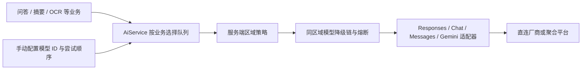

# 通用 AI 服务

业务代码调用 `AiService.generate(route, request)`。`AiRequest` 支持文本、图片、多轮消息、system 指令和输出 token 上限；OCR 使用同一服务，并在 `OcrService` 保留识别结果校验和本地 OCR 备用方案。现阶段不包含流式输出、工具调用、语音和 embedding，需要时按各自协议能力扩展。

## 结构与设计取舍



协议适配器负责 HTTP 请求和响应，平台配置负责地址、凭据、实际处理区域及模型队列；直连与聚合平台使用相同接口。`ProviderChain` 继续负责失败降级、总时间预算、指标和熔断。没有引入新的 SDK、网关服务或生产依赖。

`ocr`、`chat` 等是业务路由名称，与厂商品牌和协议无关。同一厂商可以配置多个模型，同一聚合平台可以配置多个协议端点。不同业务的断路器相互隔离。OCR 的格式不合格时会继续尝试下一个模型，最后尝试本地识别；通用文本业务默认拒绝空结果，也可传入自己的结果校验函数。

## 区域与监管边界

- `AI_SERVICE_REGION=MAINLAND` 是默认值，只允许配置为中国境内处理的端点；`OVERSEAS` 用于独立的境外部署。两个区域之间不自动降级。
- 区域由服务端配置决定，前端参数、用户 IP、模型名称和供应商品牌均不能改变它。
- 聚合平台按平台及其下游的实际数据处理位置分类。境外平台托管的国产模型仍按境外服务处理。
- HTTPS、禁止重定向、凭据只放请求头、日志不记录 prompt/图片/响应正文。
- 区域字段是运维声明，不是网络定位或监管认证。配置前须核实实际部署、下游路由、数据保留条款、模型授权、服务地区及适用的备案和个人信息处理义务。仅加上地区字段不能证明完整合规。可在部署网络层增加地域对应的出站地址限制。

监管参考：[生成式人工智能服务管理暂行办法](https://www.cac.gov.cn/2023-07/13/c_1690898327029107.htm)。是否适用、数据出境条件和具体义务需按实际业务确认。

## 已提供的服务配置

| 默认处理区域 | 厂商或平台 | 接口方式 |
| --- | --- | --- |
| MAINLAND | 豆包、DeepSeek、通义、智谱 GLM、Moonshot/Kimi、MiniMax、百度千帆、腾讯混元 | OpenAI Chat 兼容接口 |
| MAINLAND | SiliconFlow 中国站 | OpenAI Chat，多模型 |
| OVERSEAS | OpenAI | Responses |
| OVERSEAS | Claude | Anthropic Messages |
| OVERSEAS | Gemini | 原生 generateContent |
| OVERSEAS | xAI/Grok、Mistral | OpenAI Chat 兼容接口 |
| OVERSEAS | OpenRouter | OpenAI Chat，多模型 |
| OVERSEAS | OpenCode | Responses、Messages、Chat、Gemini 分开配置，统一平台密钥 |

这些是可配置的适配入口，不表示所有账号和模型均已取得访问权限或通过真实推理验收。各平台支持的模型和视觉能力会变化；需要使用对应账号当前可用的 API 型号。只开通订阅不一定具有通用 API 权限。

## 配置与使用

从 `.env.template` 选择服务端凭据、地址和队列。不同业务队列分别配置，例如：

```dotenv
AI_SERVICE_REGION=MAINLAND
QWEN_CHAT_MODELS=qwen-plus
QWEN_OCR_MODEL=qwen-vl-plus
```

示例型号用于说明配置方式，使用前核对服务商当前目录。一个变量可以配置逗号分隔的多个型号，按列表顺序尝试。所有业务队列默认留空，不内置模型型号。空队列不启用该业务，空 API key 不启用该端点。平台之间按 `priority` 从小到大降级。

```java
String answer = aiService.generate("chat", AiRequest.text("请总结这段公开资料……"));
String extracted = aiService.generate("ocr", AiRequest.image("提取文字", "image/png", base64));
```

增加 `summary` 等业务路由时，在对应端点的 `routes` 下添加模型队列，不需要新增厂商类：

```yaml
routes:
  chat: [approved-text-model]
  summary: [approved-text-model]
  ocr: [approved-vision-model, approved-backup-vision-model]
```

应用自己的 Spring 配置覆盖端点列表时，列表整体替换，不会按 ID 自动合并；需要保留所有希望启用的端点。凭据从部署平台的 Secret 或环境变量注入，不放在配置正文中。

同一个模型可以出现在多个业务队列。配置 OCR 时必须选支持图片输入的模型，不能仅根据名字或厂商判断。未来如果增加不支持图片的协议，须明确拒绝相应请求，不能悄悄丢弃图片。

## 模型由配置决定

模型 ID、数量和尝试顺序完全由部署者配置。服务不定时拉取模型目录，不推断模型新旧或质量，不自动加入、删除或替换型号，也不做额外推理评测。

新增或替换模型时，修改对应的 `*_CHAT_MODELS`、`*_OCR_MODEL` 或 YAML `routes`。更新部署环境变量后重启应用使配置生效。本地修改 `.env` 后需要重新启动 `bootRun`。

可以只配置一个模型，也可以配置多个备用型号。模型错误、下线、超时或返回不符合业务校验的内容时，按当前配置尝试下一个模型；连续失败由熔断器暂时跳过，等待恢复探测。这不会修改配置中的型号列表。永久停用某个型号时，手动从配置中删除。

## 原配置迁移

- `OPENAI_API_KEY`、`CLAUDE_API_KEY`、`GEMINI_API_KEY`、`DEEPSEEK_API_KEY`、`DOUBAO_API_KEY` 继续有效；原 `*_OCR_MODEL` 用作 `ocr` 队列，可填写多个型号。
- 新增通用 `*_BASE_URL`，原 `*_OCR_BASE_URL` 继续作为后备读取。`CLAUDE_OCR_API_URL` 原来是完整 `/messages` URL，现在改用 `CLAUDE_BASE_URL=https://api.anthropic.com/v1`。
- 原 `AI_OCR_PROVIDER` 未实际控制旧降级链，现已从模板移除；现在由区域、业务队列和 priority 共同决定。
- 所有厂商的模型配置默认留空，需明确填写所需业务的模型 ID；原有显式设置的 `*_OCR_MODEL` 继续有效。
- 旧 `AI_MODEL_CATALOG_*` 设置和端点 `catalog-path` 已不再使用。AI 模型目录的定时任务、Actuator `aimodels` endpoint 和缓存读写已移除；既有 Redis 目录键不再参与模型选择，无需操作历史数据。
- 从旧版升级后默认 `MAINLAND`，旧配置中只有境外密钥时仅使用本地 OCR。启用境内厂商或另行批准境外部署的配置后，才会调用对应 AI 服务。

## 协议依据

- [OpenAI 图像与视觉](https://developers.openai.com/api/docs/guides/images-vision)
- [OpenCode Inference API](https://opencode.ai/v2/docs/console/api/inference/)、[模型与数据处理地区](https://opencode.ai/v2/docs/console/models/)
- [通义 OpenAI 兼容接口](https://help.aliyun.com/zh/model-studio/qwen-api-via-openai-chat-completions/)、[DeepSeek Vision](https://api-docs.deepseek.com/guides/vision/)
