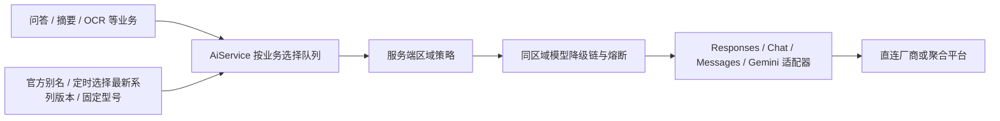

# 通用 AI 服务

业务代码调用 `AiService.generate(route, request)`。`AiRequest` 支持文本、图片、多轮消息、system 指令和输出 token 上限；OCR 使用同一服务，并在 `OcrService` 保留识别结果校验和本地 OCR 备用方案。现阶段不包含流式输出、工具调用、语音和 embedding，需要时按各自协议能力扩展。

## 结构与设计取舍



协议适配器负责 HTTP 请求和响应，平台配置负责地址、凭据、实际处理区域及模型队列；直连与聚合平台使用相同接口。`ProviderChain` 继续负责失败降级、总时间预算、指标和熔断。没有引入新的 SDK、网关服务或生产依赖。

`ocr`、`chat` 等是业务路由名称，与厂商品牌和协议无关。同一厂商可以配置多个模型，同一聚合平台可以配置多个协议端点。不同业务的断路器相互隔离。OCR 的格式不合格时会继续尝试下一个模型，最后尝试本地识别；通用文本业务默认拒绝空结果，也可传入自己的结果校验函数。

## 区域与监管边界

- `AI_SERVICE_REGION=MAINLAND` 是默认值，只允许配置为中国境内处理的端点；`OVERSEAS` 用于独立的境外部署。两个区域之间不自动降级。
- 区域由服务端配置决定，前端参数、用户 IP、模型名称和供应商品牌均不能改变它。
- 聚合平台按平台及其下游的实际数据处理位置分类。境外平台托管的国产模型仍按境外服务处理。
- HTTPS、禁止重定向、凭据只放请求头、日志不记录 prompt/图片/响应正文。
- 区域字段是运维声明，不是网络定位或监管认证。配置前须核实实际部署、下游路由、数据保留条款、模型授权、服务地区及适用的备案和个人信息处理义务。仅加上地区字段不能证明完整合规。可在部署网络层增加地域对应的出站地址限制。

监管参考：[生成式人工智能服务管理暂行办法](https://www.cac.gov.cn/2023-07/13/c_1690898327029107.htm)。是否适用、数据出境条件和具体义务需按实际业务确认。

## 已提供的服务配置

| 默认处理区域 | 厂商或平台 | 接口方式 |
| --- | --- | --- |
| MAINLAND | 豆包、DeepSeek、通义、智谱 GLM、Moonshot/Kimi、MiniMax、百度千帆、腾讯混元 | OpenAI Chat 兼容接口 |
| MAINLAND | SiliconFlow 中国站 | OpenAI Chat，多模型 |
| OVERSEAS | OpenAI | Responses |
| OVERSEAS | Claude | Anthropic Messages |
| OVERSEAS | Gemini | 原生 generateContent |
| OVERSEAS | xAI/Grok、Mistral | OpenAI Chat 兼容接口 |
| OVERSEAS | OpenRouter | OpenAI Chat，多模型 |
| OVERSEAS | OpenCode | Responses、Messages、Chat、Gemini 分开配置，统一平台密钥 |

这些是可配置的适配入口，不表示所有账号和模型均已取得访问权限或通过真实推理验收。各平台支持的模型和视觉能力会变化；需要使用对应账号当前可用的 API 型号。只开通订阅不一定具有通用 API 权限。

## 配置与使用

从 `.env.template` 选择服务端凭据、地址和队列。不同业务队列分别配置，例如：

```dotenv
AI_SERVICE_REGION=MAINLAND
AI_MODEL_AUTO_UPDATE=true
# 留空采用自动规则；填写型号则固定该业务队列
QWEN_CHAT_MODELS=
QWEN_OCR_MODEL=
```

示例型号用于说明配置方式，使用前核对服务商当前目录。一个变量可以配置逗号分隔的多个型号，按列表顺序尝试。显式队列默认留空，使用下述自动规则；空 API key 不启用该端点。平台之间按 `priority` 从小到大降级。

```java
String answer = aiService.generate("chat", AiRequest.text("请总结这段公开资料……"));
String extracted = aiService.generate("ocr", AiRequest.image("提取文字", "image/png", base64));
```

增加 `summary` 等业务路由时，在对应端点的 `routes` 下添加模型队列，不需要新增厂商类：

```yaml
routes:
  chat: [approved-text-model]
  summary: [approved-text-model]
  ocr: [approved-vision-model, approved-backup-vision-model]
```

应用自己的 Spring 配置覆盖端点列表时，列表整体替换，不会按 ID 自动合并；需要保留所有希望启用的端点。凭据从部署平台的 Secret 或环境变量注入，不放在配置正文中。

同一个模型可以出现在多个业务队列。配置 OCR 时必须选支持图片输入的模型，不能仅根据名字或厂商判断。未来如果增加不支持图片的协议，须明确拒绝相应请求，不能悄悄丢弃图片。

## 自动使用最新模型

`AI_MODEL_AUTO_UPDATE=true` 默认启用自动选择，分两种方式：

1. **官方别名**：DeepSeek `deepseek-flash`、通义 `qwen-plus-latest` / `qwen-vl-plus-latest`、Gemini `gemini-flash-latest`、Mistral `mistral-small-latest`。应用直接发送该 ID，平台更新其背后的版本，不需要额外查目录或重启。
2. **版本目录**：其他默认规则在启动 30 秒后、此后每 6 小时通过当前端点的模型目录选择指定系列的最大数字版本。刷新结果直接替换调用队列，下一次业务请求即使用新型号。例如 `gpt-6.1-sol` 替换 `gpt-6-sol`，`claude-sonnet-5-5` 替换 `claude-sonnet-5`。按数字比较版本，`10` 大于 `9`；不把目录创建时间、列表位置或字符串排序当作新旧依据。

“最新”限定在同一系列和档位：OpenAI Sol、Claude Sonnet、Gemini Flash、豆包 Seed Lite 等，不自动从轻量型号跳到旗舰档，也不代表质量评测结果。通义的 `qwen-plus-latest` 跟随 Plus 别名，并不表示 Qwen 平台全部系列中最新的模型。Gemini 官方说明 `latest` 可以指向稳定版、预览版或实验版；需要固定行为时填写明确型号。目录规则使用完整系列模式，默认不匹配 preview、实验、免费专用、音频、embedding 或代码专用后缀。

目录规则在端点的 `automatic-routes` 配置：

```yaml
automatic-routes:
  chat:
    - pattern: 'claude-sonnet-(?<version>[0-9]+(?:[.-][0-9]{1,2})?)(?:-(?<revision>[0-9]{8}))?'
      image-input: true
  summary:
    - pattern: 'claude-sonnet-(?<version>[0-9]+(?:[.-][0-9]{1,2})?)(?:-(?<revision>[0-9]{8}))?'
      image-input: true
```

每条规则只保留一个最新型号，多条规则按配置顺序组成队列。新增系列时由服务端配置明确其协议和图片能力；平台目录不能改变端点、区域、认证方式或准许的系列。如果目录提供能力元数据，明确不支持图片或文本输出的型号会被排除。请求含图片时还会过滤仅批准文本输入的自动规则。显式队列仍由部署者负责选择兼容型号。

只有当前区域、有 API key、且存在未被显式队列覆盖的版本规则的端点才查目录。OpenCode 的目录固定使用同一批准主机的 `/inference/v1/models`，各协议端点只匹配对应系列。完整分页成功后一次替换结果，移除目录中消失、明确 deprecated / retired / unavailable 或已到期的型号。失败、响应格式错误、分页中断或循环时保留上次成功结果和原更新时间，状态标为失败；成功空目录会清空选择。未首次成功更新时不猜测型号，继续其他平台或本地备用方案。目录快照仅存内存，重启后重新刷新。

`AI_MODEL_INITIAL_DELAY_MS`、`AI_MODEL_REFRESH_MS` 控制定时周期。内部 Actuator `aimodels` 提供当前选择、更新时间、是否需要目录及刷新结果，默认不通过 HTTP 暴露；不含凭据、提示词或图片。官方别名无需目录，刷新时间和结果为 null，不能据此断言调用已通过。不会发送额外推理请求，不增加付费质量测试；正常业务使用的新型号仍按平台价格收费。

填写 `*_CHAT_MODELS`、`*_OCR_MODEL` 或非空 `routes` 会覆盖该业务的自动规则，可固定单个型号或有序备用队列。`AI_MODEL_AUTO_UPDATE=false` 关闭所有自动规则，只使用显式队列。自定义端点无法从目录判定兼容系列时，配置官方别名、明确系列规则或固定型号，不任意挑选目录中一个模型。

依据：[Gemini 别名规则](https://ai.google.dev/gemini-api/docs/models#latest)、[通义系列说明](https://help.aliyun.com/zh/model-studio/faq-about-alibaba-cloud-model-studio)、[DeepSeek 视觉接口](https://api-docs.deepseek.com/guides/vision/)、[Mistral 视觉接口](https://docs.mistral.ai/studio/conversations/vision)、[Claude 模型目录](https://platform.claude.com/docs/en/api/models/list)。

## 原配置迁移

- `OPENAI_API_KEY`、`CLAUDE_API_KEY`、`GEMINI_API_KEY`、`DEEPSEEK_API_KEY`、`DOUBAO_API_KEY` 继续有效；原 `*_OCR_MODEL` 用作 `ocr` 队列，可填写多个型号。
- 新增通用 `*_BASE_URL`，原 `*_OCR_BASE_URL` 继续作为后备读取。`CLAUDE_OCR_API_URL` 原来是完整 `/messages` URL，现在改用 `CLAUDE_BASE_URL=https://api.anthropic.com/v1`。
- 原 `AI_OCR_PROVIDER` 未实际控制旧降级链，现已从模板移除；现在由区域、业务队列和 priority 共同决定。
- 原有非空 `*_OCR_MODEL` 继续固定该业务队列；留空则使用新自动规则。仅配置 key 就会启用当前区域端点已提供的自动规则；需要保持全部手动配置时设置 `AI_MODEL_AUTO_UPDATE=false`。
- 旧 `AI_MODEL_CATALOG_*` 设置不再使用，改用 `AI_MODEL_AUTO_UPDATE` / `AI_MODEL_REFRESH_MS`。不读取旧 Redis 目录缓存，无需操作历史数据。
- 从旧版升级后默认 `MAINLAND`，旧配置中只有境外密钥时仅使用本地 OCR。启用境内厂商或另行批准境外部署的配置后，才会调用对应 AI 服务。

## 协议依据

- [OpenAI 图像与视觉](https://developers.openai.com/api/docs/guides/images-vision)
- [OpenCode Inference API](https://opencode.ai/v2/docs/console/api/inference/)、[模型与数据处理地区](https://opencode.ai/v2/docs/console/models/)
- [通义 OpenAI 兼容接口](https://help.aliyun.com/zh/model-studio/qwen-api-via-openai-chat-completions/)、[DeepSeek Vision](https://api-docs.deepseek.com/guides/vision/)
